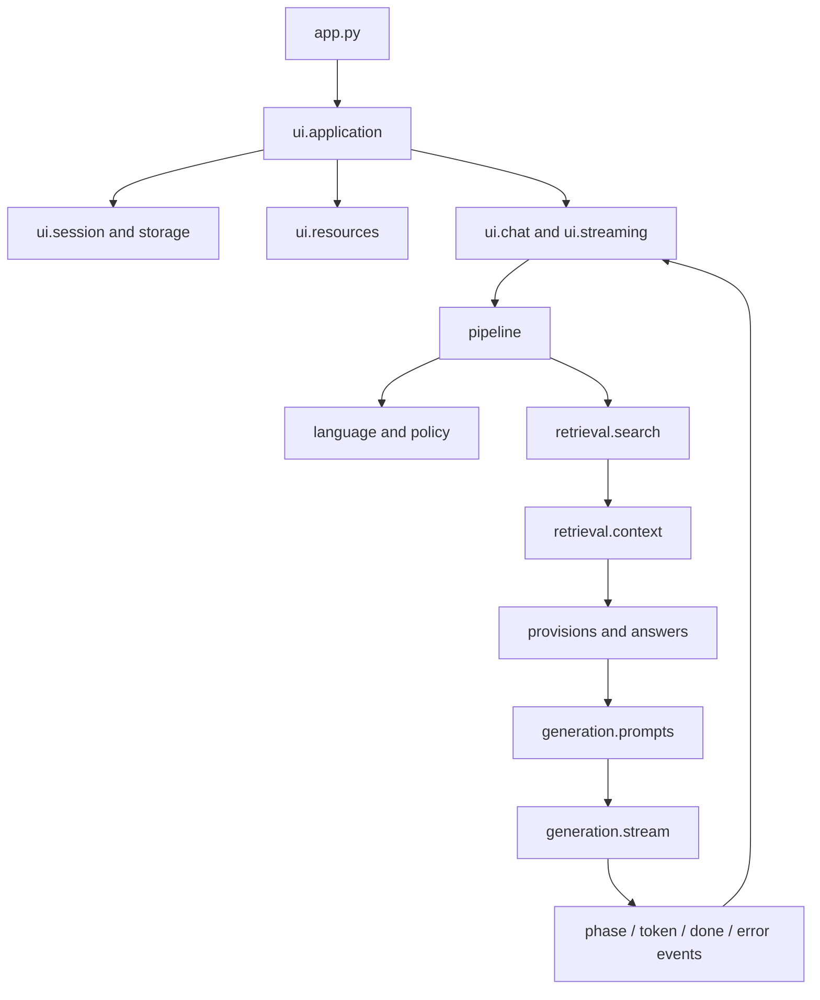

# Architecture and Debugging

## Runtime Boundaries

`app.py` calls `configure_runtime()` before importing the application. This loads
the environment and configures the model cache before any machine-learning
library is imported. Importing `app` alone does not render a page, open SQLite,
contact a generator, or load a model.

`ui/application.py` initializes session state and routes the page. Diagnostics
read the saved message without loading models or requiring a reachable generator.
The UI resource adapter caches expensive embedding, FAISS, metadata, and BM25
objects. Request-specific values such as the diagnostics message ID are read
on every rerun, not stored in module globals.

The backend does not import Streamlit or command-line scripts. It receives its
client, retriever, indexes, corpus, output queue, and cancellation event through
`run_pipeline_in_thread()`. Source-specific fallback searches receive that same
corpus explicitly.



## Ownership

| Change | Module |
| --- | --- |
| Greeting wording or Khmer tokenization | `language.py` |
| Question scope rules | `policy.py` |
| Retrieval thresholds or model paths | `config.py` |
| Dense/BM25 search and fusion | `retrieval/search.py` |
| Context size and document selection | `retrieval/context.py` |
| Exact article/provision answers | `provisions.py` |
| Structured website answer shortcuts | `answers.py` |
| Prompt instructions | `generation/prompts.py` |
| Provider request options and retries | `generation/stream.py` |
| Token counting and model discovery | `generation/client.py` |
| Answer normalization | `text.py` |
| Chat layout and action buttons | `ui/` and `assets/ui/` |
| Conversations and evaluation feedback | `storage.py` |
| Category assignment shared with ingestion | `categories.py` |

## Request and State Flow

1. The UI stores a submitted question in session state. Greeting-only messages
   receive the fixed Khmer reply with no sources or diagnostics row.
2. `ui/streaming.py` starts a worker and saves its queue and cancellation event
   in session state so Streamlit reruns can resume consuming it.
3. The pipeline checks language and scope, retrieves candidates, selects source
   context, and resolves a verbatim or structured answer when applicable.
4. Other questions go through the generator. It retries only before any text
   has been emitted and closes the stream on completion, error, or cancellation.
   The frequency penalty is sent only to local llama-server.
5. The UI consumes `phase`, `token`, `canned_response`, `out_of_domain`, `done`,
   and `error` events. `commit_message()` writes completed state through to SQLite.

The saved message dictionary and queue event payloads retain the existing
schema. Old conversations can be reopened. `static/documents/` still exposes
local legal PDFs through hard links or copies; website sources retain their URLs.

## Debugging

Run the fast checks from the repository root:

```sh
python -m unittest discover -s tests -v
ruff check .
ruff format --check .
```

Pipeline failures log a traceback with the responsible module. Set `LOG_LEVEL=DEBUG`
for additional stream cleanup diagnostics. Application log messages do not
deliberately include questions, retrieved documents, or credentials; provider
exceptions may contain request details, so inspect logs before sharing them.

For a wrong answer, start with the answer's information button. Confirm the
retrieved document, year, page metadata, and raw text before changing the prompt.
FAISS similarity is used for the relevance gate; fused RRF scores have a different
scale and must not be substituted for similarity scores.

For missing data, inspect extraction outputs and the chunk metadata, then run
the corpus smoke test. Do not restart OCR merely because generation failed.
For a provider error, inspect the endpoint, model ID, and `generation/stream.py`.
For presentation issues, edit `assets/ui/chat.css` or the relevant UI component.

## Refactor Validation

The refactor preserves the existing data paths, source IDs, models, prompt text,
greeting wording, answer rules, and persistence schema. Changes beyond relocation:

- FAISS padding indices no longer resolve to the last chunk in a small corpus.
- Failed and cancelled generator streams close their connections reliably.
- Source-specific fallback lookup uses the supplied corpus instead of globals.
- Diagnostics can open when the generator is offline.
- Evaluation commands share runtime helpers instead of copied implementations.

Offline tests cover these behaviors with controlled inputs and a temporary SQLite
database. They do not measure generation quality, execute JavaScript in a browser,
or replace a model-backed retrieval evaluation.

## Remaining Limitations

`answers.py` preserves narrow rules tied to particular source documents,
including fixed 2025 company counts and a profile summary. These are not a
general solution for other years or people. Replace them with validated,
year-aware structured records in a separate accuracy change.

Some presentation helpers still target Streamlit's browser DOM and use its
legacy iframe component API. The pinned Streamlit version keeps current behavior;
upgrade it with browser interaction checks for copy, scrolling, and resizing.

The numbered data and research scripts retain their command interfaces. They
are not all import-safe libraries. Experiment-specific model launchers, output
budgets, and historical reports remain separate from the live pipeline.

The BM25 cache assumes the corpus is unchanged during a server process. After
rebuilding the index, restart the application to reload matching metadata and
rankers. Multi-user authentication and conversation isolation are not implemented.
